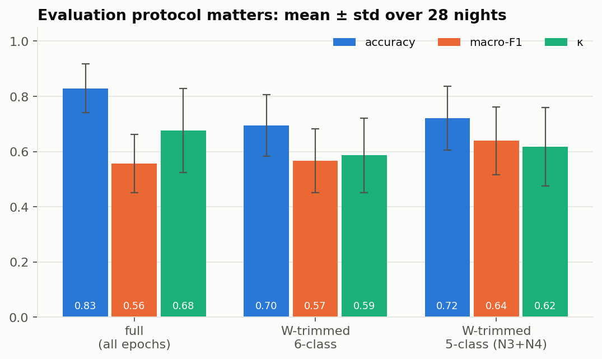
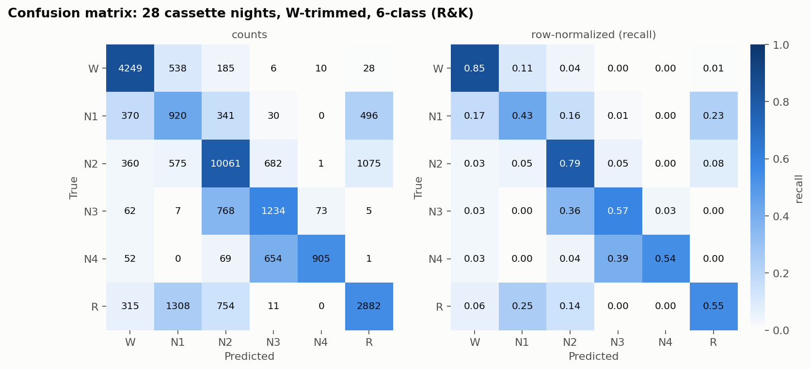
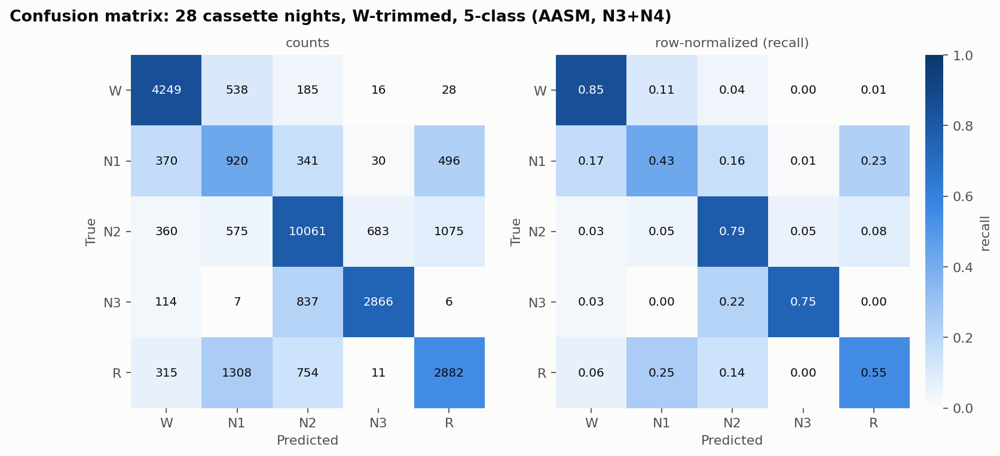
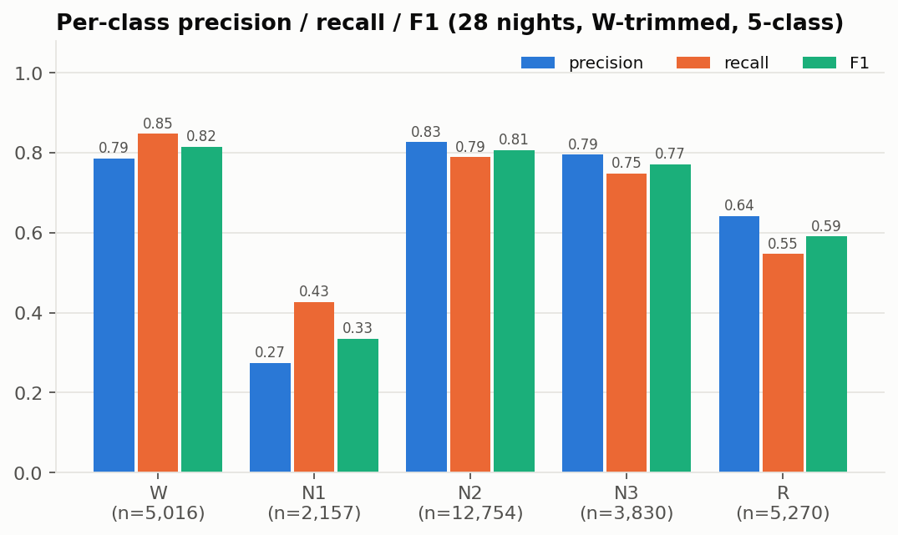
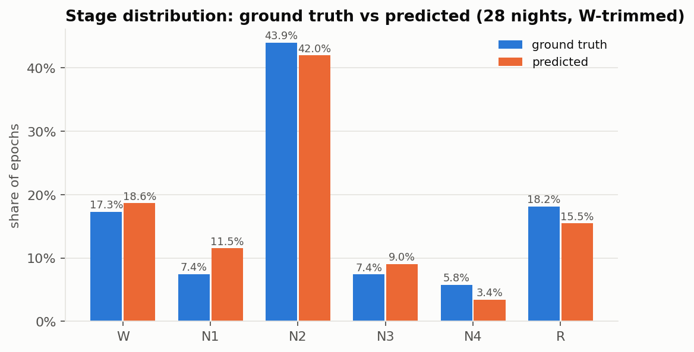
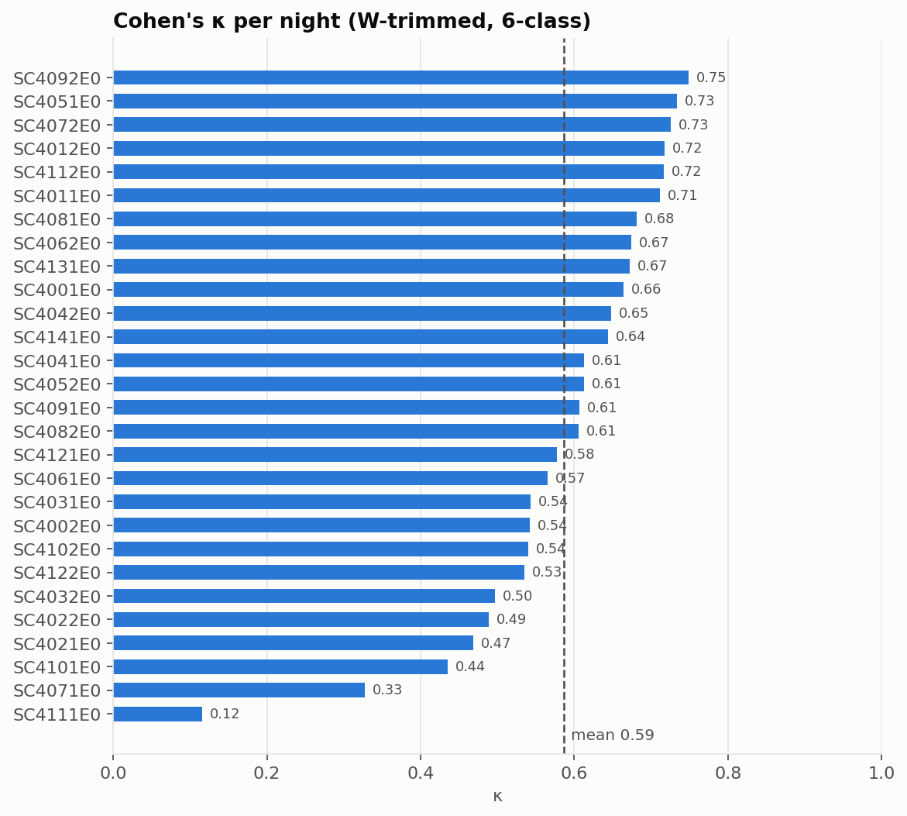
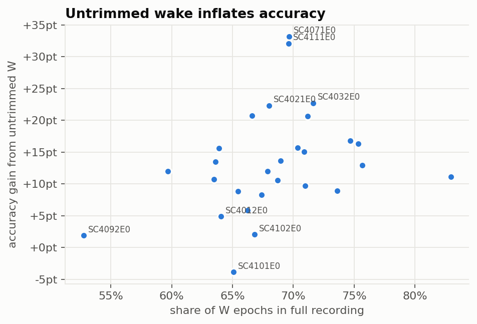
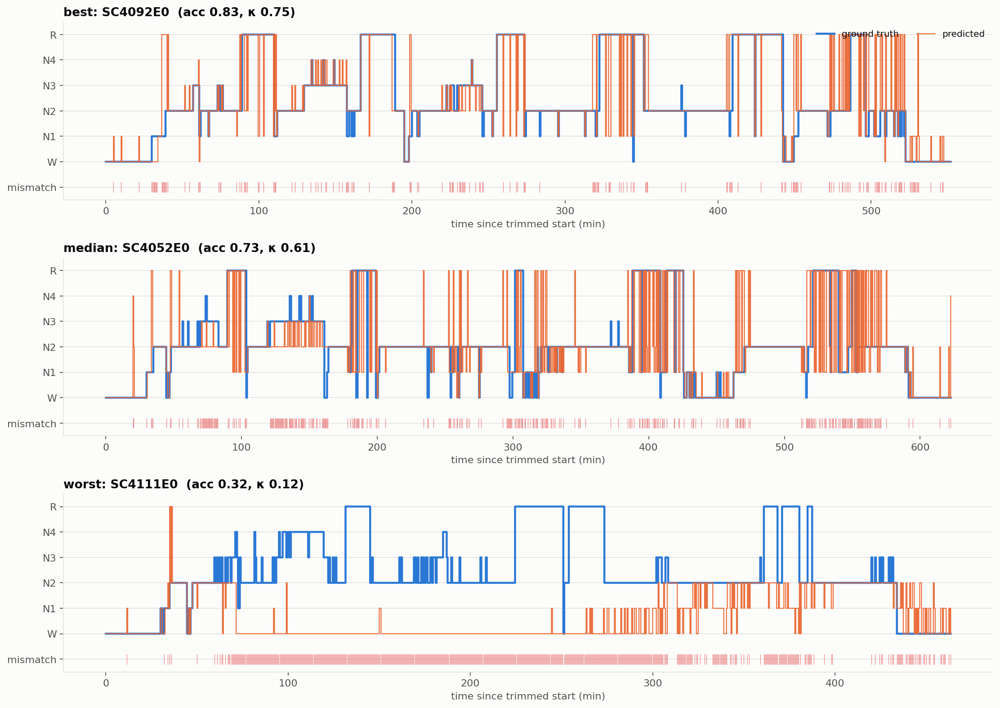
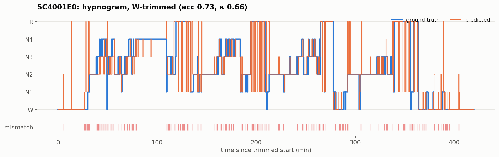

# Sleep-EDF 수면 단계 분류 (CNN + BiLSTM)

Sleep-EDF Database Expanded (telemetry, ST7*) 의 EEG 2채널(`Fpz-Cz`, `Pz-Oz`)로 30초 epoch 단위 6단계(W / N1 / N2 / N3 / N4 / R) 분류.
Colab 노트북 2개로 진행한 실험을 **전처리 → 정규화 → 불균형 처리 → 모델 → 학습 → 추론 → 시각화** 로 모듈 분리한 레포.

> 배경 논문/수면 점수 설계: [docs/research.md](docs/research.md) · 개념 정리: [docs/notes.md](docs/notes.md) · 보고서(PDF) 요약 및 노트북과의 차이: [docs/report_pdf_summary.md](docs/report_pdf_summary.md)
> 데이터셋: https://physionet.org/content/sleep-edfx/1.0.0/

---

## Pipeline

```
PSG.edf + Hypnogram.edf
   │  01_inspect_edf      pyedflib 헤더/채널/샘플 수 확인
   ▼
   │  02_edf_to_fif       채널 2개 선택 + annotation 부착 → *-raw.fif
   ▼
   │  03_make_npy         annotation → 샘플 라벨 → 30s epoch(mode 라벨, -1 포함 epoch 제외) → X_ST7*.npy / Y_ST7*.npy
   ▼
   │  04_train            피험자 단위 split(6:2:2) → SMOTE(train) → z-score(train 통계) → CNN-BiLSTM → 평가/혼동행렬 → model.keras, mean.npy, std.npy
   ▼
   │  05_predict          단일 밤 예측 → GT vs Pred hypnogram, 혼동행렬, report
   ▼
   │  06_eval_cassette    cassette 28밤 일괄 추론 → per-night npy + metrics.csv (full / W-trimmed / 5-class)
   ▼
   │  07_make_figures     metrics.csv + npy → confusion / κ per night / per-class / hypnogram 등 figure 일괄 생성
   ▼
   │  08_stream_predict   배포용: band-pass → 10 min 세그먼트 병렬 추론 → REM/W 후처리 → JSON (PDF 10장)
```

## 구조

```
src/
├── config.py                  # STAGE_MAP, 채널, epoch 길이, 기본 경로, 하이퍼파라미터
├── preprocessing/
│   ├── edf_inspect.py         # pyedflib 메타 확인
│   ├── edf_to_fif.py          # edf → fif (채널 선택)
│   ├── labeling.py            # annotation → 샘플 단위 라벨
│   └── epoching.py            # 30s epoch 분할, npy 저장
├── normalization/
│   └── zscore.py              # fit / apply / save / load (train 통계만 사용)
├── data/
│   ├── subjects.py            # ST7 피험자 ID 목록 (PSG / Hypnogram 짝)
│   ├── cassette.py            # SC4 파일 짝 매칭 (hypnogram suffix 가변)
│   ├── split.py               # 피험자 단위 train/val/test split
│   └── loader.py              # npy 로드 + concat
├── imbalance/
│   ├── smote.py               # SMOTE (flatten → resample → reshape)
│   └── class_weight.py        # balanced / sqrt softened / manual
├── models/
│   └── cnn_bilstm.py          # Conv1D×2 → BiLSTM×2 → Dense → softmax
├── training/
│   └── train.py               # compile / fit(EarlyStopping) / evaluate
├── evaluation/
│   └── metrics.py             # κ / macro-F1, W trimming, N3+N4 병합
├── deploy/
│   ├── stream_predict.py      # 세그먼트 병렬 추론 + JSON (배포 버전)
│   └── postprocess.py         # REM 보정, 연속 W 컷
├── inference/
│   ├── predict.py             # mne.Epochs 기반 epoch 생성, 모델 로드, 예측 (y_true = epochs.events 정렬)
│   └── smoothing.py           # 이동 윈도우 최빈값 smoothing
└── visualization/
    ├── eeg_hypnogram.py       # EEG + hypnogram 오버레이
    ├── stage_distribution.py  # 단계 분포 bar
    ├── hypnogram_compare.py   # GT vs Pred 2단 hypnogram
    ├── confusion.py           # confusion matrix(sklearn / seaborn) + report
    └── style.py               # 공통 팔레트/rcParams
scripts/      01~08 실행 스크립트 (argparse)
setup/        conda env(pjh_skin) 설치 스크립트
notebooks/    원본 Colab 노트북
docs/         research.md, notes.md
results/      figures/ (이미지 붙여넣기 위치)
```

## 실행

```bash
pip install -r requirements.txt
export SLEEP_ROOT=/path/to/sleep-telemetry   # 생략 시 Colab 경로 기본값

RAW=$SLEEP_ROOT/sleep-edf-database-expanded-1.0.0/sleep-telemetry

python scripts/01_inspect_edf.py --psg $RAW/ST7242J0-PSG.edf
python scripts/02_edf_to_fif.py  --psg $RAW/ST7242J0-PSG.edf --hyp $RAW/ST7242JO-Hypnogram.edf --out data/fif
python scripts/03_make_npy.py    --fif data/fif/ST7242J0-PSG-raw.fif --hyp $RAW/ST7242JO-Hypnogram.edf --out data/npy --plot
# 02~03 을 src/data/subjects.py 의 모든 피험자에 반복 → data/npy 에 X_ST7*.npy / Y_ST7*.npy
python scripts/04_train.py       --merge-dir data/npy --stats-dir artifacts --model-out artifacts/model.keras
python scripts/05_predict.py     --fif data/fif/ST7242J0-PSG-raw.fif --hyp $RAW/ST7242JO-Hypnogram.edf \
                                 --model artifacts/model.keras --mean artifacts/mean.npy --std artifacts/std.npy

# 외부 검증 (cassette 28밤) + figure
python scripts/06_eval_cassette.py --raw-dir /path/sleep-cassette --model artifacts/model_4.keras --mean artifacts/mean.npy --std artifacts/std.npy
python scripts/07_make_figures.py
```

## 설계 결정

| 단계 | 선택 | 이유 |
|---|---|---|
| 포맷 | edf → fif 경유 | mne 에서 annotation 과 함께 빠른 재로딩 |
| 채널 | `EEG Fpz-Cz`, `EEG Pz-Oz` | Sleep-EDF 표준 EEG 2채널 |
| epoch | 30 s, 라벨 = mode. 학습용(`--train-style`)은 undefined→W, 제외 없음 / 평가용은 `-1` epoch 제외 | AASM 표준. 두 방식은 PDF vs 노트북 차이 |
| split | 파일 단위 7:1.5:1.5 (`test_size=0.3`) | 보고서 기준. **같은 피험자 두 밤이 분리 안 됨** → 아래 이슈 1 |
| 정규화 | z-score, **train 통계만** 산출 후 저장 | 누수 방지, EEG 이상치에 min-max 보다 둔감 |
| 불균형 | SMOTE(train) | class_weight 는 코드 보존, 최종 모델은 미사용 |
| 모델 | CNN front-end + BiLSTM | 지역 파형 특징 + 시간 의존성. 소규모 데이터라 Dropout 0.5 |
| 후처리 | window=5 최빈값 smoothing | 단일 epoch 튐 억제 (수면 단계는 연속성 큼) |

## 결과

### 외부 검증: Sleep-EDF cassette 14명 × 2밤 = 28밤 (model_4, 학습에 전혀 사용 안 됨)

telemetry 로 학습한 `model_4` 를 cassette(가정 측정, 건강군) 에 그대로 적용. 피험자·도메인 모두 미학습 → **누수 없는 수치**.
cassette 는 ~20h 녹화라 취침 전후 W 가 과반 → 첫/마지막 수면 epoch 기준 ±30 min 으로 trimming (DeepSleepNet 관행).

| 프로토콜 | accuracy | macro-F1 | κ |
|---|---|---|---|
| 전체 epoch (W 미제거) | 0.83 ± 0.09 | 0.56 ± 0.11 | 0.68 ± 0.15 |
| **W-trimmed, 6-class (R&K)** | 0.70 ± 0.11 | 0.57 ± 0.12 | **0.59 ± 0.14** |
| **W-trimmed, 5-class (AASM, N3+N4)** | 0.72 ± 0.12 | 0.64 ± 0.12 | **0.62 ± 0.14** |

평균 ± 표준편차 (28밤). 참고: DeepSleepNet(Supratak 2017), 같은 데이터셋 Fpz-Cz, 20명 CV, in-domain → acc 0.82 / MF1 0.77 / κ 0.76.



#### Confusion matrix (28밤 합산, W-trimmed)




- N2 recall 0.79, W 0.85 — 안정. N3↔N4 상호 혼동 큼(0.36 / 0.39) → 5-class 병합 시 해소.
- **R → N1 오분류 25%**, N1 → R 23%. EEG 2채널만으로 REM/N1 구분 한계. EOG 추가가 1순위 개선책.

#### Per-class / 분포 / 밤별 편차





- 밤별 κ 0.12 ~ 0.75. `SC4111E0`(κ 0.12), `SC4071E0`(0.33) 두 밤은 W/N1 로 붕괴 → 피험자 간 진폭 편차 의심. per-recording 정규화 필요 근거.



- W 비율이 높을수록 untrimmed accuracy 부풀림 증가 (+10 ~ +25 pt). accuracy 단독 보고 금지 근거.

#### Hypnogram




### 초기 실험 (telemetry, 피험자 누수 있음 — 참고용)

- 내부 테스트셋 accuracy ≈ 0.78 (smoothed). hold-out `ST7242J0` accuracy 0.82 / macro-F1 0.67.
- **`ST7241J0`(같은 피험자 1밤)이 train 에 포함** → 위 수치는 generalization 증거로 쓸 수 없음. 위 cassette 결과로 대체.

```
--- ST7242J0 분류 성능 보고서 (누수 포함) ---
              precision    recall  f1-score   support
           W       1.00      0.65      0.79        17
          N1       0.23      0.55      0.32        22
          N2       0.94      0.89      0.91       591
          N3       0.57      0.79      0.66        98
          N4       0.59      0.49      0.53        41
           R       0.88      0.75      0.81       170
    accuracy                           0.82       939
   macro avg       0.70      0.68      0.67       939
```

## 알려진 이슈 / TODO

노트북 로직을 그대로 옮겼으므로 아래 사항은 **코드에 그대로 남아 있음**. 재현성 확보 후 수정 권장.

1. **val/test 2차 split 에 `random_state` 없음** → 실행마다 val/test 피험자 달라짐. `split_subjects(..., val_test_random_state=42)` 로 고정 가능.
2. **학습/추론 epoching 경로 불일치** : 학습은 numpy 슬라이싱 + mode 라벨(`epoching.make_epochs`), 추론은 `mne.events_from_annotations` + `mne.Epochs`(`inference.predict`). 경계 처리/제외 epoch 이 다를 수 있음.
3. **SMOTE 후 정규화 통계 산출** : mean/std 가 합성 샘플에 영향 받음. 순서 교체 또는 SMOTE 제거 검토.
4. **class_weight vs SMOTE** : 노트 결론은 class weighting, 실제 모델은 SMOTE. `--no-smote --class-weight` 로 비교 실험 필요.
5. **모델 버전 불일치** : 학습 노트북은 `model_5.keras` 저장, 추론 노트북은 `model_4.keras` 로드. 82% 결과는 model_4 기준.
6. **N4 분리** : R&K 기준 N3/N4 분리 상태. AASM 기준으로 N3+N4 병합(5-class) 시 성능/비교 가능성 향상 기대.
7. 추론 정규화만 `eps=1e-7` 사용 (학습은 0). 수치상 무시 가능.
8. 수면 점수 계산식(docs/research.md)은 설계만 존재, 미구현.

수정 완료: `inference/predict.py` 의 y_true 정렬은 `epochs.events[:,2]` 로 교체됨 (드롭 epoch 시 밀림 방지). W trimming / κ / 5-class 는 `evaluation/metrics.py` 로 추가됨.
