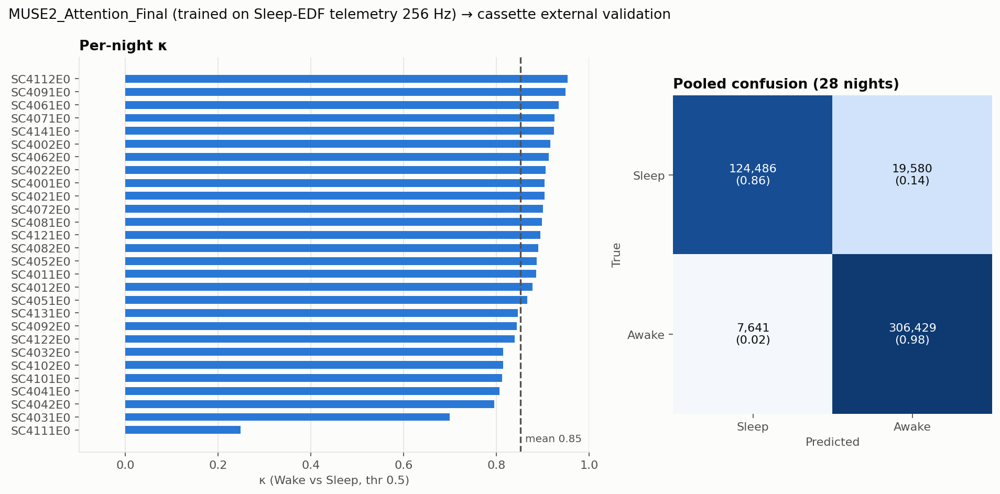
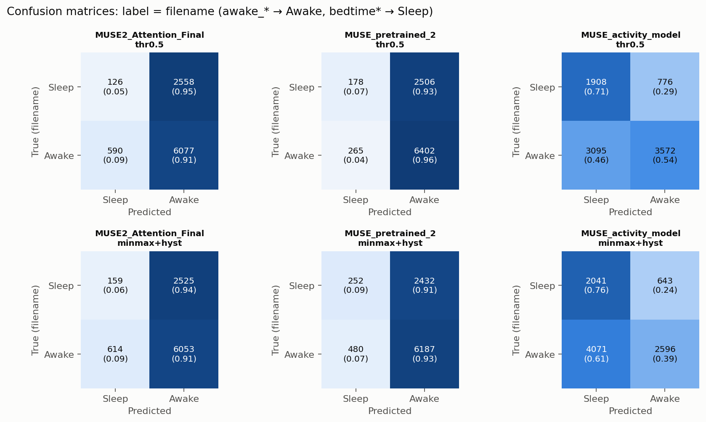
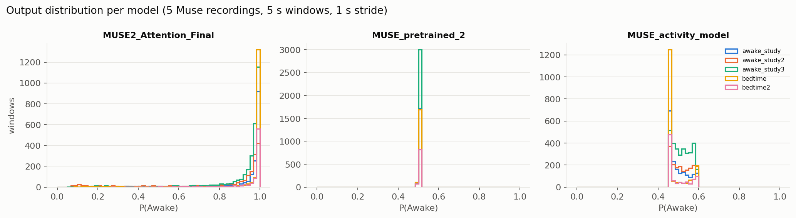
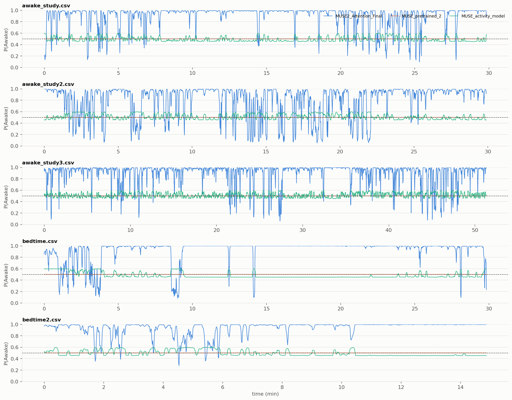
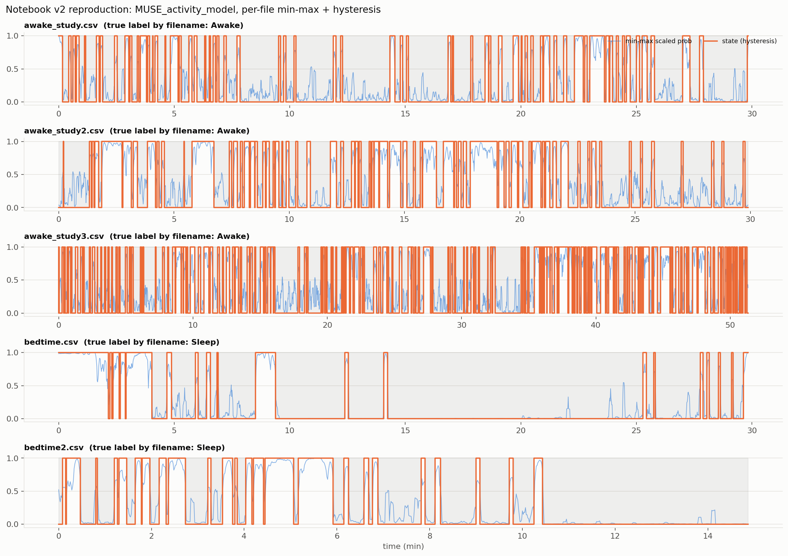

# Muse 2 기기 적용 실험 — Wake/Sleep 이진 분류 + fine-tuning

캡스톤 후반, Sleep-EDF 로 만든 모델을 **소비자용 EEG 헤드밴드(Muse 2)** 에 실제로 올려보는 시도.
결론부터: **PSG 데이터에서는 작동하는 모델이 Muse 데이터에서는 작동하지 않았고, 캡스톤 기간 안에 해결하지 못함.** 아래는 무엇을 했고, 어디서 막혔고, 왜 막혔는지의 기록.

## 한 것

```
Sleep-EDF telemetry (100 Hz) ─resample 256 Hz─► 5 s 윈도우, Wake/Sleep 이진 라벨
        │
        ▼  CNN-BiGRU-Attention (31k params)              ── MUSE2_Attention_Final.keras
        │  Sleep-EDF 내부 test acc 0.95 (노트북)
        │
        ▼  Muse 2 CSV 5개 (각성 3 / 취침 2, AF7·AF8)
        │  activity(|diff| 평균) 30/70 백분위로 pseudo-label
        ▼  fine-tune                                    ── MUSE_activity_model.keras
        │
        ▼  추론: min-max scaling + hysteresis            ── 노트북 acc 0.53
```

| 단계 | 파일 |
|---|---|
| 전처리·윈도우 | `msrc/preprocess.py`, `msrc/windows.py` (band-pass 0.5–40 Hz, median, clip ±100, z-score) |
| 모델 | `msrc/model.py` — 재구성 + 가중치 로드 (원본은 Keras 3.13 저장, 3.12 에서 `load_model` 불가) |
| Sleep-EDF 이진 데이터 | `msrc/sleepedf_binary.py` — 원본 256 Hz npy·생성 코드 유실 → edf 에서 복원 |
| pseudo-label / fine-tune | `msrc/activity_label.py`, `scripts/04_finetune_activity.py` |
| 후처리 | `msrc/postprocess.py` — hysteresis, min-max |
| 실행 | `scripts/01_convert_models.py` → `02_infer_csv.py` → `03_eval_base_on_cassette.py` |

```bash
# repo root 에서
python muse2/scripts/01_convert_models.py
python muse2/scripts/02_infer_csv.py
python muse2/scripts/03_eval_base_on_cassette.py --raw-dir /path/sleep-cassette
```

## 결과

### 1. 기초 모델은 PSG 에서 작동함 — cassette 28밤 외부 검증

학습에 쓰지 않은 Sleep-EDF cassette 14명 28밤, Wake vs Sleep, 5 s 윈도우.

| | acc | F1 | κ |
|---|---|---|---|
| thr 0.5 | 0.94 ± 0.04 | 0.96 ± 0.03 | **0.85 ± 0.13** |
| thr 0.779 (노트북 최적값) | 0.93 ± 0.05 | 0.95 ± 0.03 | 0.85 ± 0.13 |



### 2. 같은 모델이 Muse 2 데이터에서는 작동하지 않음

파일명을 정답으로 사용 (`awake_*` = Awake, `bedtime*` = Sleep). 5 s 윈도우, 1 s stride, 총 9,351 윈도우.

| 모델 | 후처리 | acc | κ | Awake recall | Sleep recall |
|---|---|---|---|---|---|
| `MUSE2_Attention_Final` | thr 0.5 | 0.66 | **-0.05** | 0.91 | 0.05 |
| `MUSE_pretrained_2` | thr 0.5 | 0.70 | +0.04 | 0.96 | 0.07 |
| `MUSE_activity_model` (fine-tuned) | thr 0.5 | 0.59 | +0.20 | 0.54 | 0.71 |
| `MUSE_activity_model` | min-max + hysteresis (노트북 v2) | 0.50 | +0.11 | 0.39 | 0.76 |

κ 0 = 무작위. 노트북의 acc 0.53 은 재현됨. 그 수치는 성능이 아니라 **실패의 기록**임.






## 왜 안 됐는지 (진단)

1. **도메인 차이가 너무 큼.** 학습: 임상 PSG, 두피 중앙(Fpz-Cz, Pz-Oz), 100 Hz. 적용: 소비자 헤드밴드, 이마(AF7, AF8), 250 Hz, 건식 전극. 신호의 주파수 구성·진폭·잡음 특성이 다름. 기초 모델이 Muse 녹화 전체를 "각성" 으로 봄 (취침 recall 0.05).
2. **`pretrained_2` 는 상수 출력 (0.502).** 학습 generator 가 초 단위 라벨 배열을 5 s 윈도우 단위로 읽어 라벨이 밀렸을 가능성 큼 (`Y` 길이 ≈ 녹화 초수, `X.reshape(-1, 1280, 2)` 와 `min(len(X), len(Y))` 로 자름). 학습이 안 된 모델.
3. **fine-tune 라벨이 수면 라벨이 아님.** `mean(|diff|)` 로 "움직임 많음/적음" 을 나눈 것. 조용히 깨어 있는 상태 = sleep-like 로 라벨됨. 이걸로 학습하면 움직임 탐지기가 됨.
4. **min-max scaling 이 결과를 왜곡.** 파일별로 확률을 0~1 로 늘리면 전부 각성인 파일에도 반드시 "sleep" 구간이 생김. 출력 범위 0.45~0.60 인 거의 죽은 모델을 억지로 살린 것.
5. **Hz 불일치.** 모델은 256 Hz 가정, Muse CSV 는 250 Hz. 5 s 윈도우가 실제론 5.12 s. 작은 문제지만 누적됨.
6. **GT 가 없음.** `awake`/`bedtime` 은 파일 단위 추정이지 epoch 단위 수면 판정이 아님. 취침 파일 앞부분은 실제로 깨어 있었을 것. 정량 평가 자체가 느슨함.

## 캡스톤 기간 내 해결하지 못한 것 / 다음에 할 것

- [ ] **Muse 데이터에 진짜 라벨 확보.** 최소한 PSG 와 동시 측정 1~2밤, 또는 공개 Muse/consumer-EEG 수면 데이터셋(예: DREEM Open Dataset, 헤드밴드 EEG + PSG 동시 기록) 으로 대체.
- [ ] **도메인 적응.** 라벨 없이도 가능한 방법부터: per-recording 정규화, 주파수 대역 파워 feature (delta/theta/alpha/beta 비율) 로 입력 추상화, 그 다음 적대적/통계적 정렬.
- [ ] **`pretrained_2` 라벨 정렬 재검증 후 재학습.** 256 Hz npy 생성 코드 복원 (`msrc/sleepedf_binary.py` 가 출발점).
- [ ] **pseudo-label 폐기.** activity 는 라벨이 아니라 feature 로만 사용.
- [ ] **min-max 제거.** 모델이 0.5 근처에만 머물면 그건 후처리가 아니라 모델 문제.
- [ ] 250 Hz 로 통일하거나 입력 전 256 Hz 로 리샘플.

## 얻은 것

- 기초 모델이 미학습 PSG 에서 κ 0.85 → **아키텍처·학습 파이프라인은 유효**. 문제는 데이터 전이.
- "모델이 안 되는 이유" 를 수치로 좁혀 놓음 (위 1~6). 다음 사람이 바로 이어받을 수 있는 상태.
- fine-tuning 파이프라인(generator, 증강, 콜백, 저장/로드) 은 그대로 재사용 가능.

## 데이터·아티팩트

- `artifacts/original/` 노트북 원본 모델 3개 (Keras 3.13). `artifacts/` 현 환경(3.12) 재저장본. 출력 동치 확인 (max |diff| = 0).
- `data/` Muse CSV 6개 (muselsl 포맷: `timestamps,TP9,AF7,AF8,TP10,Right AUX`). **git 미포함** (126 MB, 개인 녹화). 별도 전달.
- `results/csv_eval.csv`, `results/cassette_binary_metrics.csv` 수치 원본.
- `docs/report_original.md` 노트북 보고서 원문. `docs/*.ipynb` 원본 노트북.
